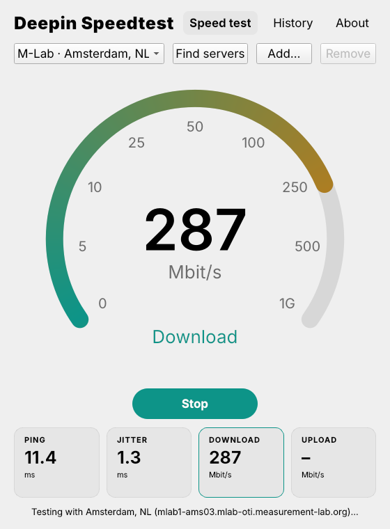
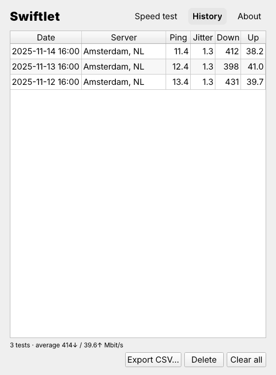

# Deepin Speedtest

An open-source, privacy-respecting internet speed test for the **Deepin** desktop and every other
Debian-based distribution (Debian, Ubuntu, Linux Mint, …).

Deepin Speedtest measures **ping, jitter, download and upload** (plus latency under load), lets you
**choose the test server**, and keeps a **local result history** you can export to CSV. It has a
desktop app (Qt) and a terminal mode.

It is an original, independent community project. It is not affiliated with Deepin Technology
(the Deepin name is used only to say which desktop it targets), nor with Ookla® or Speedtest®, and it does
not use their servers or APIs.

| Speed test | History |
| --- | --- |
|  |  |

## Install

Download `deepin-speedtest_<version>_all.deb` (and `SHA256SUMS`) from the
[latest release](https://github.com/RealAct/deepin-speedtest/releases/latest), check it and install it:

```sh
sha256sum -c --ignore-missing SHA256SUMS
sudo apt install ./deepin-speedtest_1.0.2_all.deb
```

The same package works on every supported distribution (it is `Architecture: all`).

### Making a release

Publish a GitHub release with a tag like `v1.2.3`. The *Release* workflow builds the `.deb`,
stamps it with that version, and attaches it and `SHA256SUMS` to the release. To add the
package to a release that already exists, run the *Release* workflow from the Actions tab and
enter its tag.

Dependencies come from your distribution's own repositories (`python3`, `python3-pyqt5`,
`ca-certificates`), so they receive the distribution's security updates. Supported: Debian 12+ (Debian 11 is end-of-life but should still work),
Ubuntu 20.04+, Linux Mint 20+, Deepin 20.9/23 (Python ≥ 3.8, Qt 5).

### Build from source

```sh
sudo apt install build-essential debhelper dh-python python3 python3-pyqt5 python3-pytest openssl
dpkg-buildpackage -us -uc -b      # runs the test suite, produces ../deepin-speedtest_1.0.2_all.deb
```

Run without installing: `python3 -m deepin_speedtest` (desktop) or `python3 -m deepin_speedtest --cli`.

## Use

* **Desktop:** open *Deepin Speedtest* from the launcher and press **Start test**. Use **Find servers** to
  pick a specific nearby server, or **Add…** to use your own server.
* **Terminal:**

  ```sh
  deepin-speedtest --cli                          # nearest public M-Lab server
  deepin-speedtest --cli --list-servers
  deepin-speedtest --cli --ndt7-server speed.example.org:4443
  deepin-speedtest --cli --librespeed https://speed.example.org/ --json
  ```

## Test servers (backends)

Deepin Speedtest speaks open, documented protocols only. See [docs/BACKENDS.md](docs/BACKENDS.md) for the
full trade-offs.

| Backend | Servers | Notes |
| --- | --- | --- |
| **ndt7** (default) | Public [M-Lab](https://www.measurementlab.net/) platform, found via the public Locate API | Free and needs no account. **M-Lab publishes every test, including your IP address, as open data.** Deepin Speedtest asks for consent before the first test. |
| **ndt7, self-hosted** | Your own [`m-lab/ndt-server`](https://github.com/m-lab/ndt-server) | Nothing leaves your infrastructure. |
| **LibreSpeed, self-hosted** | Your own [LibreSpeed](https://github.com/librespeed/speedtest) install | Multi-stream HTTPS test, easy to host. |

## Security and privacy

Security was the top design priority. In short:

* **No telemetry, no accounts, no ads.** History stays in `~/.local/share/deepin-speedtest` (mode 0600).
* **No root, ever.** Deepin Speedtest refuses to start as root, and nothing needs `sudo`. Latency is
  measured with TCP handshakes instead of ICMP, so no raw-socket capability is needed.
* **TLS everywhere.** Only `wss://` and `https://`, certificate verification always on, TLS ≥ 1.2,
  no redirects followed, and no switch to turn any of this off.
* **Privilege separation and sandboxing.** The UI never touches the network. Measurements run in
  a separate engine process that, before opening a socket, drops into a **Landlock** sandbox. In it
  the engine cannot write any file, read your home directory or run programs, and (on Linux 6.7+)
  it can only make TCP connections to the ports the test needs. It also runs with
  `no_new_privs`, resource limits and a minimal environment.
* **Validated inputs.** Server addresses, Locate API responses, WebSocket frames, engine
  messages, settings and history are all checked against strict rules and size limits.
* **Minimal dependencies.** Python's standard library plus PyQt5 from your distribution: no
  pip and no vendored third-party code. CI actions are pinned to commit SHAs.

Details and the threat model are in [docs/SECURITY.md](docs/SECURITY.md). To report a
vulnerability, see [SECURITY.md](SECURITY.md).

## Development

```sh
make test     # unit, protocol, sandbox and GUI smoke tests (run as a normal user)
make lint     # check that the code stays Python 3.8 compatible
```

The tests include local TLS ndt7 and LibreSpeed servers, protocol-violation cases (bad
handshakes, masked server frames, oversized frames, untrusted certificates) and a Landlock test
that checks the sandbox really blocks file reads, writes, `execve` and other TCP ports.

## License

GPL-3.0-or-later. See [LICENSE](LICENSE).
